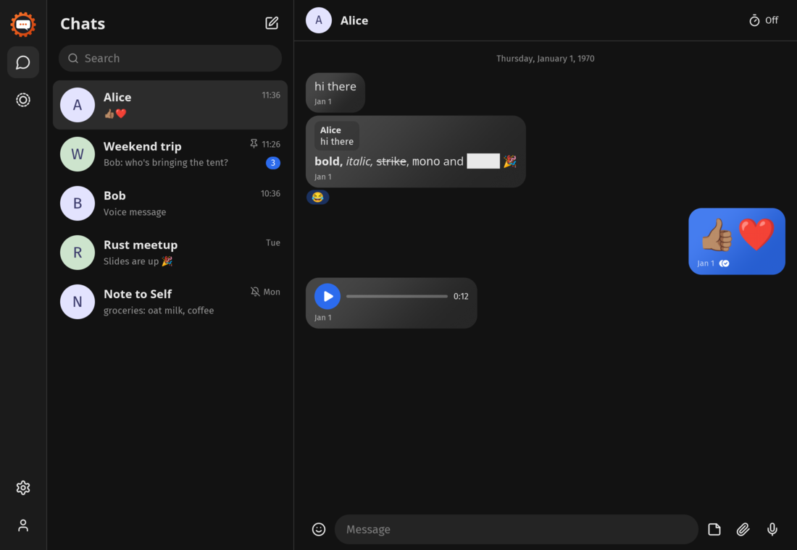
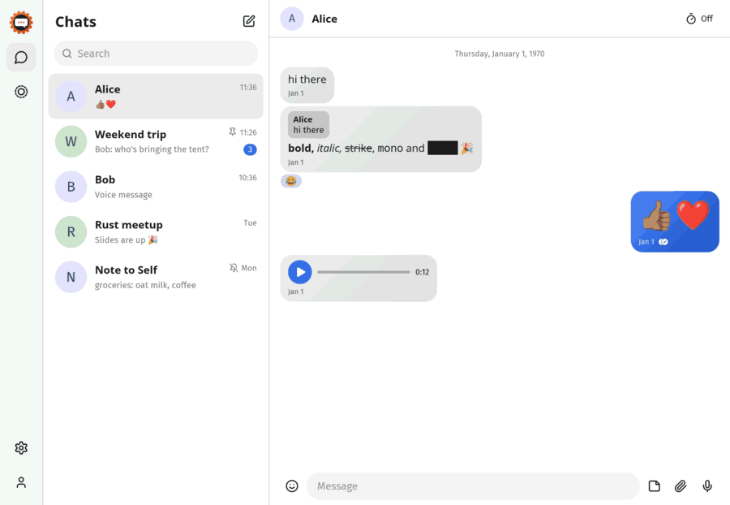
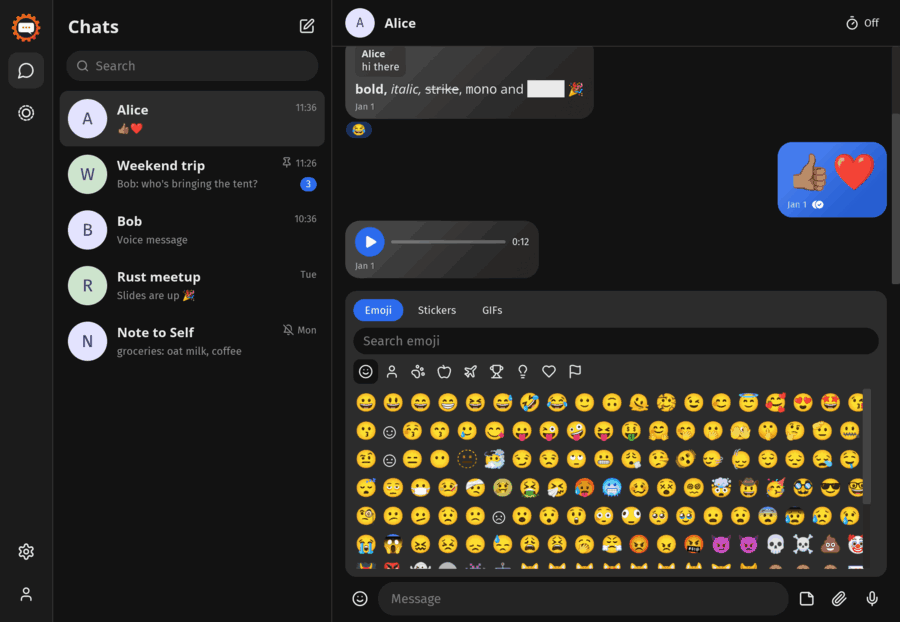
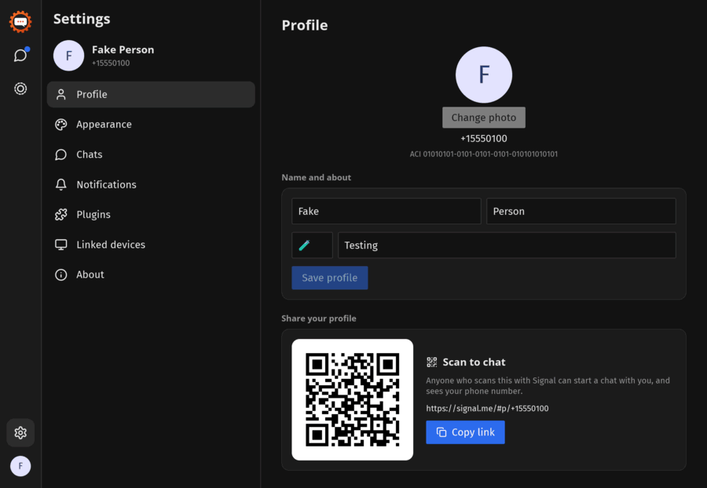
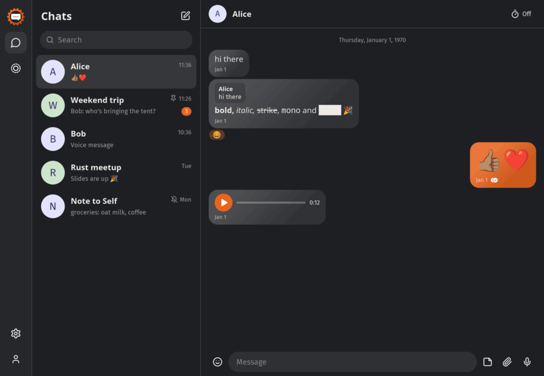
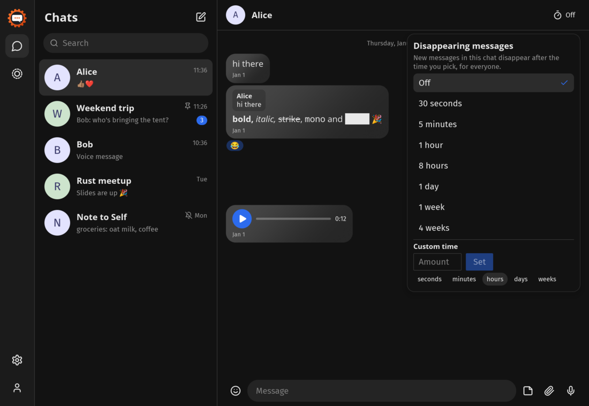
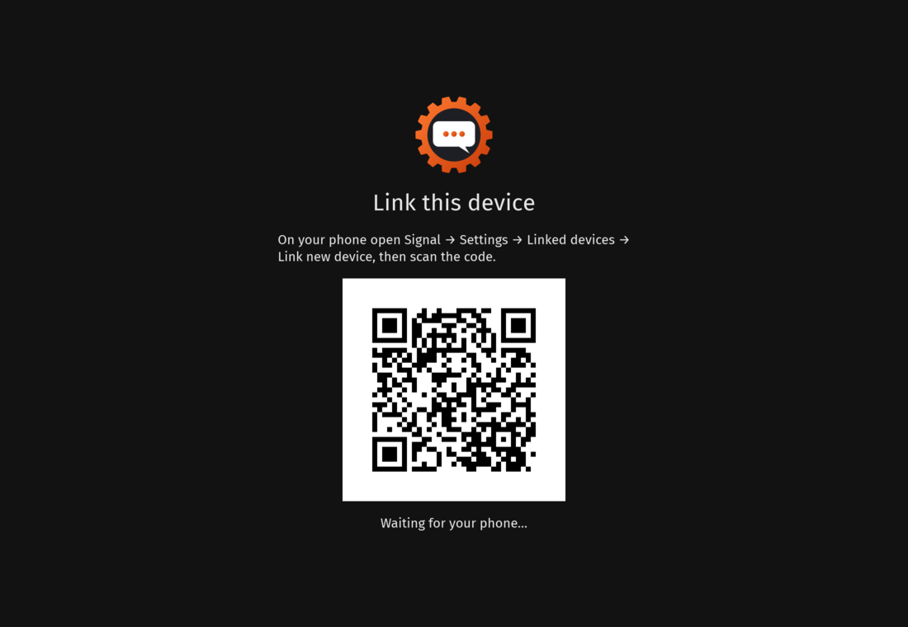

<div align="center">


# signal-rusted

**A native Signal desktop client written in Rust.**
No Electron, no web engine: an [iced](https://iced.rs) GUI on top of
[presage](https://github.com/whisperfish/presage) and Signal's own
[libsignal](https://github.com/signalapp/libsignal).




</div>

> [!WARNING]
> **Unofficial.** Not affiliated with or endorsed by Signal Messenger, LLC. "Signal" is their
> trademark. This client hasn't been security-audited. For anything sensitive, use the
> official apps.

## Contents

- [Highlights](#highlights)
- [Features](#features)
- [Performance](#performance)
- [Install and build](#install-and-build)
- [Using it](#using-it)
- [Security and privacy](#security-and-privacy)
- [How it's built](#how-its-built)
- [Roadmap](#roadmap)
- [Contributing](#contributing)
- [License](#license)

## Highlights

<table>
<tr>
<td width="50%"><b>Nine themes, plus your own</b><br>Light, Dark, Midnight, Rusted, Nord, Sakura, Mint and Everforest, or build a custom theme in the app and share it as a file.<br><br></td>
<td width="50%"><b>Emoji, stickers and GIFs in one panel</b><br>Sticker packs synced from your phone, and GIF search through GIPHY or Tenor.<br><br></td>
</tr>
<tr>
<td><b>Settings laid out like Signal Desktop's</b><br>Profile (with photo and a QR code to share), Appearance, Chats, Notifications, Plugins and linked devices.<br><br></td>
<td><b>Round or square</b><br>One switch squares off every bubble, avatar, photo and panel.<br><br></td>
</tr>
<tr>
<td><b>Disappearing messages</b><br>Signal's presets with a custom time, in a dropdown like the official app's.<br><br></td>
<td><b>Links as a secondary device</b><br>Scan the QR code with Signal on your phone; your message history can come along.<br><br></td>
</tr>
</table>

All screenshots are rendered from the test suite's fake data (`scripts/readme-media.sh`), not a
real account.

## Features

**Messaging**
- 1:1 and group chats: send and receive, replies, reactions, edits, delete for me or everyone
- Rich text: **bold**, *italic*, ~~strikethrough~~, `monospace` and spoilers, plus @mentions
- Emoji picker with categories and search, `:shortcode:` expansion and jumbo emoji
- Stickers: installed packs, recents, and one-click install of packs someone sends you
- GIFs: search and send through GIPHY or Tenor; received `.gif` files animate
- Attachments: file picker or drag and drop, an image viewer, and file cards for documents
- Voice notes: record and play, surviving Bluetooth headset mic switching
- Read and delivery receipts, typing indicators, message requests
- Disappearing messages with presets or a custom time
- Link previews on received messages

**Chats and people**
- Chat list synced from Signal's storage service: contacts, groups, pins, archive, mute, mark unread
- Message search
- Groups: create, rename, describe, add and remove members, leave
- Stories: view and reply
- Your profile: name, about, emoji, profile photo, and a signal.me QR code to share
- Profile names and avatars of your contacts and groups

**Desktop**
- Themes: nine built in, custom themes made in the app or dropped in as JSON files
- Round or square corners everywhere
- Desktop notifications, with or without message text
- Plugins: your own programs that react to messages ([docs/plugins.md](docs/plugins.md))
- Optional 1:1 voice calls through Signal's RingRTC ([docs/calls.md](docs/calls.md))

## Performance

Measured against the official Signal Desktop (8.32.0, Flathub) as the control, same account and
machine (Ryzen AI 7 350, 32 GB, Arch Linux, KDE Wayland), with `scripts/bench.py`. It follows
each app's whole process tree and reads `/proc`: memory is PSS (shared pages split fairly between
processes), so Electron's helper processes are counted once.

| | signal-rusted | Signal Desktop | |
|---|---:|---:|---|
| Memory after start-up, idle | **217 MiB** | 590 MiB | 2.7× less |
| Peak memory during start-up | **242 MiB** | 737 MiB | 3.0× less |
| Memory with a large chat open¹ | **250 MiB** | 744 MiB | 3.0× less |
| CPU while idle | **0.0 %** | 2.6 % | |
| CPU used to start | **0.4 s** | 3.0 s | 7.5× less |
| Start-up, until the CPU goes quiet | **~1 s** | ~3 s | |
| Processes | **1** | 11 | |
| Size on disk | **49 MiB** (stripped binary) | 392 MiB (Flatpak) | 8× less |

Idle rows are the median of 3 runs: 30 s to settle, then 30 s of sampling.

¹ A group chat of roughly 400 messages with photos and links, scrolled back to its first message
in both apps, measured once each. Signal Desktop's window was larger (maximised), which costs it
some extra memory. **Known issue:** with that chat open, signal-rusted kept using ~22 % of one
CPU core instead of going idle (Signal Desktop: 0.1 %); this is being looked into.

```sh
cargo build --release
scripts/bench.py target/release/signal-rusted "flatpak run org.signal.Signal" --runs 3
```

## Install and build

There are no prebuilt packages yet. You need stable Rust, `protoc` and a C toolchain.

```sh
git clone https://github.com/Guilherme-M-Mateus/signal-rusted
cd signal-rusted
cargo run --release
```

Voice calls are an optional feature with extra build steps; see [docs/calls.md](docs/calls.md).
`packaging/signal-rusted.desktop` and `assets/` provide a launcher entry and icon.

Data lives in `~/.local/share/signal-rs` (the name from before the project was renamed, kept so
existing installs keep working). `SIGNAL_RS_DATA=/some/dir` runs a separate profile.

## Using it

**Linking.** Start the app, name the device, and scan the QR code from Signal on your phone
(*Settings → Linked devices → Link new device*). Choose to transfer your message history if you want it.

**GIFs.** GIPHY and Tenor both require an API key. Get a free one at
[developers.giphy.com](https://developers.giphy.com) (or a Tenor key from the Google Cloud
console, restricted to the Tenor API) and paste it into *Settings → Chats*.

**Custom themes.** *Settings → Appearance → New theme* opens an editor with a live preview.
Each theme is a small JSON file in the `themes` folder of the data directory, so you can share
them or drop in someone else's:

```json
{ "name": "Ocean", "background": "#0b1d2a", "text": "#e0f2ff", "accent": "#2bb3c0" }
```

**Plugins.** Put an executable in the `plugins` folder and enable it in *Settings → Plugins*.
It reads chat events as JSON lines on stdin and writes actions to stdout. See
[docs/plugins.md](docs/plugins.md) and the [auto-reply example](examples/plugins/auto-reply.py).

**Drag and drop.** Drop files on the window to attach them. On a native Wayland session the
window library (winit) doesn't deliver drops yet; run with `WAYLAND_DISPLAY=` to use XWayland.

## Security and privacy

| | |
|---|---|
| **Protocol** | End-to-end encryption by Signal's own libsignal (Signal Protocol with PQXDH), through presage and libsignal-service-rs. Messages only go to Signal's servers. |
| **Device model** | A linked secondary device, like Signal Desktop. It can't register a phone number, and you can unlink it from your phone at any time. |
| **Message database** | SQLCipher, with a random 256-bit key kept in the OS keyring (Secret Service, macOS Keychain, Windows Credential Manager). Without a keyring the key falls back to a `db.key` file readable only by you (`0600`). |
| **Not encrypted at rest** | Downloaded attachments, avatars, GIFs, `state.json` (settings, including GIF API keys), stories, themes and plugins. Use full-disk encryption. |
| **History transfer** | The phone's archive key is written `0600` and deleted once the import finishes. |
| **Unlinking** | *Settings → Linked devices → Unlink* deletes the database, keys, attachments, avatars, GIFs and settings, and removes the keyring entry. |
| **Third-party requests** | None by default. GIF search talks directly to GIPHY or Tenor once you add a key, and they see your IP address. (Signal Desktop proxies GIPHY; this client doesn't yet.) Sending never fetches link previews, and links open in your browser only when clicked. |
| **Profile photos** | Encrypted with your profile key (AES-256-GCM) before upload, as Signal does. |
| **Plugins** | Off until you enable each one. An enabled plugin runs as your user, reads the text of your messages, and can send messages to chats already in your list (not to message requests). Only run plugins you trust. |
| **Notifications** | Can show message text; turn that off under *Settings → Notifications*. |
| **Telemetry** | None. |

Found a security problem? Please contact the maintainer privately rather than opening a
public issue.

## How it's built

```
┌──────────── UI thread (iced) ────────────┐        ┌──── backend thread (tokio) ────┐
│ app.rs   state + update                  │Command │ backend.rs  presage manager    │
│ view.rs  rendering, themes, settings     │──────▶│ storage sync, history import   │
│ icons.rs line icons                      │◀──────│ attachments, avatars, stickers │
│ gifs.rs  search + animation              │ Event  └───────────────┬────────────────┘
│ plugins.rs child processes (JSON lines)  │                        │ libsignal-service
└──────────────────────────────────────────┘                  Signal servers
```

- `src/backend.rs`: presage on its own thread; commands in, events out
- `src/app.rs`, `src/view.rs`: UI state and update, and rendering
- `src/timeline.rs`: folds stored messages (edits, reactions, receipts…) into the timeline
- `src/history.rs`: link-time history import; `src/storage.rs`: storage-service sync
- `src/gifs.rs`, `src/themes.rs`, `src/plugins.rs`: GIFs, custom themes, plugins
- `vendor/`: presage, vendored with small changes marked `signal-rs:`

Tests drive the real UI headlessly with `iced_test`, including screenshot tests:

```sh
cargo test
scripts/readme-media.sh   # re-render the images in this README
```

## Roadmap

- [x] Linking with message history transfer
- [x] Messaging, rich text, reactions, replies, edits, deletes
- [x] Stickers, GIFs, voice notes, file attachments
- [x] Groups, stories, profiles, profile photos
- [x] Themes, custom themes, square corners
- [x] Plugins
- [x] 1:1 voice calls (optional build)
- [ ] Play Signal's GIFs (sent as MP4 video) and other video
- [ ] Proxy GIF searches the way Signal Desktop does
- [ ] Usernames and username links (sharing currently uses your phone number)
- [ ] Group calls and video calls
- [ ] Drag and drop on native Wayland
- [ ] Encrypt the attachment cache at rest
- [ ] Sending link previews
- [ ] Stories: posting
- [ ] Prebuilt packages (Flatpak, AUR)
- [ ] Windows and macOS builds
- [ ] Plugin permissions and rate limits

## Contributing

Issues and pull requests are welcome. Please run `cargo test` and `cargo clippy` before
sending a change, and keep commits focused.

## License

AGPL-3.0-only (see [LICENSE](LICENSE)), as required by presage and libsignal. Icons in
`src/icons.rs` follow [Lucide](https://lucide.dev)'s shapes (ISC license).
